# 👻 Ghost Cursor

**Application-Aware Autonomous AI Co-pilot as a Service**

Ghost Cursor transforms passive website chatbots into **active, screen-aware autonomous co-pilots**. It does not simply answer questions by outputting walls of text — it **navigates the website, selects items, fills forms, executes multi-step workflows, runs guided interactive tours, and asks clarifying questions**, all with explicit user approval and a visible on-screen animated cursor.

Ghost Cursor is offered as a B2B SaaS platform that any web application (e-commerce, SaaS, fintech dashboards, internal tools) can integrate with **minimal code changes** (~11 lines of total glue code, < 1 hour of developer effort) using our **Frontend SDK** and **Backend Gateway SDK**.

---

## 📑 Table of Contents

1. [Executive Summary & Value Proposition](#-executive-summary--value-proposition)
2. [Market Opportunities & Differentiators](#-market-opportunities--differentiators)
3. [Key Features Offered](#-key-features-offered)
4. [Process Flow & Architecture Diagrams](#-process-flow--architecture-diagrams)
   - [End-to-End Process Flow Diagram](#end-to-end-process-flow-diagram)
   - [System Topology & Cloud Infrastructure](#system-topology--cloud-infrastructure)
5. [Complete Technology Stack](#-complete-technology-stack)
6. [Repository Directory Structure](#-repository-directory-structure)
7. [Local Setup Guide (Step-by-Step)](#-local-setup-guide-step-by-step)
   - [Prerequisites](#1-prerequisites)
   - [Virtual Environment Setup (Python)](#2-virtual-environment-setup-python)
   - [Installing Dependencies](#3-installing-dependencies)
   - [Environment Configuration (.env)](#4-environment-configuration-env)
8. [Running the Application Locally](#-running-the-application-locally)
   - [Option A: Running Services Manually (Recommended for Dev)](#option-a-running-services-manually)
   - [Option B: Running via Docker Compose](#option-b-running-via-docker-compose)
9. [Switching to Real Google Agent Platform (Gemini 2.0 Flash / Pro)](#-switching-to-real-google-agent-platform-gemini-20-flash--pro)
   - [Google Cloud Credentials Required](#1-google-cloud-credentials-required)
   - [Authentication Methods](#2-authentication-methods)
   - [Enabling Live Agent Platform Mode](#3-enabling-live-agent-platform-mode)
10. [Deploying to Google Cloud Platform (GCP)](#-deploying-to-google-cloud-platform-gcp)
    - [GCP Managed Architecture Overview](#1-gcp-managed-architecture-overview)
    - [Deploying Cloud Run Services via gcloud](#2-deploying-cloud-run-services-via-gcloud)
    - [Frontend Deployment on Firebase Hosting](#3-frontend-deployment-on-firebase-hosting)
    - [Infrastructure as Code with Terraform](#4-infrastructure-as-code-with-terraform)
11. [Customer Showcase Demo: ShopHive](#-customer-showcase-demo-shophive)
    - [Interactive Demo Scenarios](#interactive-demo-scenarios)
    - [Customer Integration Code Delta Audit](#customer-integration-code-delta-audit)
12. [Implementation Effort & Cost Economics](#-implementation-effort--cost-economics)
13. [Future Scope & Roadmap](#-future-scope--roadmap)
14. [Testing & Quality Assurance](#-testing--quality-assurance)

---

## 💡 Executive Summary & Value Proposition

* **What is Ghost Cursor?**  
  A plug-and-play B2B SaaS platform that turns static chatbots into **screen-aware autonomous co-pilots**.
* **Core Value Proposition:**  
  Traditional bots tell users what to do; Ghost Cursor **performs the actual task** on the user's screen in real-time.
* **How It Operates:**  
  1. **Lightweight Frontend SDK (~5 lines):** Embeds an interactive, Shadow DOM-isolated chat widget, a dynamic screen context scanner, and an animated cursor engine.  
  2. **Customer Backend Gateway SDK (~6 lines):** Automatically resolves dynamic page-specific business context (Markdown Brain), injects authentic user identity (`X-Ghost-Subject`), and executes customer backend tools.  
  3. **Hosted SaaS Orchestrator:** Built in Python 3.12 with **Google Agent Development Kit (ADK)** and Gemini models via **Google Agent Platform**, invoking fixed frontend action tools (`navigate`, `click`, `fill_input`, `select_option`, `toggle_switch`, `guided_tour`).  
  4. **Animated Ghost Cursor:** Navigates, highlights, clicks, and fills forms directly on the customer's web app upon explicit user approval.
* **Outcome:** Eliminates user drop-offs, reduces support tickets by up to 70%, and provides friction-free onboarding.

---

## 🚀 Market Opportunities & Differentiators

* **How It Differs from Existing Tools:**  
  * *Traditional Bots (Intercom, Zendesk):* Only deliver static text/FAQs; cannot interact with the UI.  
  * *Digital Adoption Platforms (WalkMe, Pendo):* Rely on rigid, brittle, pre-recorded scripts; cannot reason dynamically.  
  * *Ghost Cursor:* Combines dynamic LLM reasoning + live DOM awareness + autonomous visual execution.
* **Problem Solved:**  
  Ends navigation drop-offs and complex form abandonment. Users avoid manual searching while businesses slash customer support overhead.
* **Unique Selling Proposition (USP):**  
  > **"Don't just explain the steps — execute them."**  
  * **Frontend Tools as Agent Tools:** The Google ADK Agent calls fixed frontend action tools; the frontend SDK deterministically executes them.  
  * **Dynamic Business Brain:** Zero technical tags. The backend SDK dynamically pairs `platform.md` with `{page}.md` to supply pure business rules.  
  * **True Plug-and-Play Integration:** Zero UI redesign needed; embeds in ~11 lines of code across modern frameworks.

---

## 🌟 Key Features Offered

| Feature | Description | Demo Verification |
|---|---|---|
| 🖥️ **Screen-Aware Guidance** | The AI inspects the active DOM, route, and inputs to answer context-specific questions rather than reciting static documentation. | User asks *"What sizes are in stock?"* on a product page → Co-pilot reads available sizes directly from the active screen. |
| 🎯 **AI Cursor Auto-Actions** | Emits structured, validated tool actions (`navigate`, `click`, `fill_input`, `select_option`, `toggle_switch`) that animate a visible on-screen ghost pointer. | User says *"Add the Air Max 90 in size 10 to my cart"* → Cursor smoothly animates to size 10, clicks it, and clicks *Add to Cart*. |
| 💡 **Dynamic Suggested Questions** | Automatically generates 2–3 contextual, page-specific question chips whenever the user visits a new page. Powered by the page brain and Gemini. | User lands on `/checkout` → Widget displays suggested chips: *"Use my saved address"*, *"What payment methods are supported?"*. |
| ❓ **Smart Clarifying Questions** | Detects ambiguities or missing form fields and prompts the user with selectable option cards before taking action. | User says *"I want to checkout"* without an address → Co-pilot prompts: *"Which shipping address should I use?"* |
| 🎬 **Guided Explainers & Tours** | Highlights elements with dark cutout polygon overlays and narrates walkthroughs step-by-step. | User asks *"How do I track my return?"* → Co-pilot runs an interactive 3-step tour spotlighting the orders nav and tracking link. |
| 🔒 **Backend Tools via Gateway Loopback** | Executes customer read-only APIs (`lookup_order`, `check_warehouse_stock`, `simulate_discount_roi`) without exposing customer databases. | User asks *"Where is order SH-1024?"* → Orchestrator requests data from the customer gateway under the user's authentic session (`X-Ghost-Subject`). |
| 🛡️ **Customer Data Sovereignty** | Ghost Cursor Cloud is a stateless reasoning engine. Chat sessions and message transcripts reside strictly in the customer's own database. | Customer uses `SQLAlchemyChatStore` to store session records inside their PostgreSQL / SQLite database. |

---

## 📐 Process Flow & Architecture Diagrams

### End-to-End Process Flow Diagram

```mermaid
%%{init: {
  "theme": "base",
  "themeVariables": {
    "background": "#FFFFFF",
    "mainBkg": "#FFFFFF",
    "primaryColor": "#FFFFFF",
    "primaryTextColor": "#172B4D",
    "primaryBorderColor": "#64748B",
    "lineColor": "#64748B",
    "secondaryColor": "#F1F6FC",
    "tertiaryColor": "#FFF3EA",
    "clusterBkg": "#FFFFFF",
    "clusterBorder": "#B8C5D6",
    "fontFamily": "Arial",
    "fontSize": "13px"
  },
  "flowchart": {
    "htmlLabels": true,
    "curve": "linear",
    "nodeSpacing": 20,
    "rankSpacing": 32,
    "padding": 6,
    "useMaxWidth": true
  }
}}%%

flowchart LR
    EU["End User"]
    ADMIN["Customer Admin / Developer"]

    subgraph CUSTOMER["CUSTOMER PLATFORM"]
        direction TB
        CHAT(["Chat & Task Delegation"])
        CONTEXT(["Capture Screen Context"])
        BRAIN(["Enrich with Platform Brain"])
        CUSTOM(["Register Custom Tools"])
        EXEC(["Execute Backend Tools"])
        UI(["Execute Approved UI Actions"])
        DISPLAY(["Display Answer & Guidance"])

        CHAT --> CONTEXT --> BRAIN
        CUSTOM -.-> BRAIN
        EXEC --> DISPLAY
        UI --> DISPLAY
    end

    subgraph SAAS["GHOST CURSOR SAAS"]
        direction TB
        REQ(["Receive Enriched Request"])
        REASON(["Reason & Select Tools"])
        PLAN(["Generate Tool Instructions"])
        ORCH(["Orchestrate Multi-Step Calls"])
        RESULTS(["Process Results & Continue"])
        FINAL(["Return Final Response"])

        REQ --> REASON --> PLAN
        PLAN --> ORCH --> RESULTS
        RESULTS -. "More steps" .-> REASON
        RESULTS --> FINAL
    end

    EU --- CHAT
    EU --- UI
    EU --- DISPLAY
    ADMIN --- CUSTOM

    BRAIN --> REQ
    PLAN --> BRAIN
    BRAIN --> EXEC
    BRAIN --> UI
    FINAL --> DISPLAY

    classDef actor fill:#FFFFFF,stroke:#334155,color:#172B4D,stroke-width:1.5px
    classDef customer fill:#F1F6FC,stroke:#5279A5,color:#173653,stroke-width:1.2px
    classDef saas fill:#FFF3EA,stroke:#D87942,color:#663718,stroke-width:1.2px

    class EU,ADMIN actor
    class CHAT,CONTEXT,BRAIN,CUSTOM,EXEC,UI,DISPLAY customer
    class REQ,REASON,PLAN,ORCH,RESULTS,FINAL saas

    style CUSTOMER fill:#FFFFFF,stroke:#5279A5,stroke-width:1.5px
    style SAAS fill:#FFFFFF,stroke:#D87942,stroke-width:1.5px

    linkStyle default stroke:#64748B,stroke-width:1.2px
```



---

### System Topology & Cloud Infrastructure

```mermaid
%%{init: {'flowchart': {'nodeSpacing': 20, 'rankSpacing': 35, 'curve': 'basis'}, 'themeVariables': {'clusterBkg': 'transparent', 'clusterBorder': 'transparent'}}}%%
flowchart LR
subgraph LeftCol[" "]
direction TB
subgraph ClientLayer["Frontend Layer — Firebase Hosting"]
direction TB
UI["ShopHive React Frontend<br/>(Vite + React 18 + Tailwind CSS)"]
SDK["Ghost Cursor Frontend SDK<br/>(@ghost-cursor/sdk)<br/>- Isolated Shadow DOM Chat Widget<br/>- Live Screen Context Scanner<br/>- Animated Cursor Engine<br/>- DOM Action Executors"]
UI <--> SDK
end
end

subgraph RightCol[" "]
    direction TB
    subgraph CustomerCloud["Customer Infrastructure — Google Cloud"]
        direction LR
        subgraph CustomerCR["Customer Backend (Cloud Run)"]
            direction LR
            CustBE["<b>ShopHive Backend API</b><br/>(FastAPI + Python 3.12)"]
            ProxySDK["<b>Ghost Cursor Backend SDK</b><br/>- Dynamic Markdown Brain Loader<br/>- Customer Session Auth<br/>- Customer Tools Registry"]
            CustBE <--> ProxySDK
        end

        subgraph CustomerDB["Customer Database (Cloud SQL)"]
            direction TB
            SQL["<b>Cloud SQL (PostgreSQL)</b><br/>- ShopHive Store Data (Catalog/Orders)<br/>- Customer Chat Store (Data Sovereignty)"]
        end
        CustBE <--> SQL
    end

    subgraph SaaSCloud["Ghost Cursor SaaS — Google Cloud"]
        direction LR
        subgraph SaaSCR["Ghost Cursor Orchestrator (Cloud Run)"]
            direction TB
            Orch["<b>SaaS Reasoning Engine</b><br/>(Python 3.12 + Google ADK)<br/>- Multi-Turn Run State Machine<br/>- Idempotency & Revision Locking<br/>- Out-of-Scope Guardrails<br/>- Suggested Prompts Generator"]
        end

        subgraph GeminiAI["LLM Provider — Google Agent Platform"]
            direction TB
            Gemini["<b>Google Gemini Models</b><br/>(Gemini 2.0 Flash / Pro)<br/>- Natural Language Understanding<br/>- Complex Reasoning & Planning<br/>- Structured JSON Plan Generation"]
        end
        
        Orch <--> Gemini
    end

    ProxySDK <-->|"Server-to-Server HTTPS<br/>Bearer API Key + X-Ghost-Subject"| Orch
end

SDK <-->|"Same-Origin HTTPS<br/>(/api/ghost-cursor)"| CustBE

style LeftCol fill:none,stroke:none
style RightCol fill:none,stroke:none
style ClientLayer fill:#ffffde,stroke:#aaaa33,stroke-width:1px
style CustomerCloud fill:#ffffde,stroke:#aaaa33,stroke-width:1px
style CustomerCR fill:#ffffde,stroke:#aaaa33,stroke-width:1px
style CustomerDB fill:#ffffde,stroke:#aaaa33,stroke-width:1px
style SaaSCloud fill:#ffffde,stroke:#aaaa33,stroke-width:1px
style SaaSCR fill:#ffffde,stroke:#aaaa33,stroke-width:1px
style GeminiAI fill:#ffffde,stroke:#aaaa33,stroke-width:1px
```



### Strict Architectural Invariants:
1. **Zero Browser-Direct Access:** The browser NEVER communicates directly with Ghost Cursor Cloud or Google Agent Platform. Private keys and Brain documents never touch client bundles.
2. **AI Plans; Frontend Deterministically Executes:** The LLM never emits arbitrary executable JavaScript. It emits typed, schema-validated tool calls with target IDs. The frontend SDK deterministically executes them using the **Element Targeting Cascade** (`data-ghost-id` → `data-testid` → `id` → `aria-label` → visible text).
3. **Pure Business Context in Brain:** Markdown Brain files contain **zero HTML tags or DOM selectors**.
4. **Customer Data Sovereignty:** Chat histories and messages are maintained in the customer's database. Ghost Cloud maintains only ephemeral run states (auto-expired after 30 minutes).
5. **Approval-First Execution:** Action sequences require explicit user confirmation (*"Approve and Run"*) before any DOM mutation occurs.
6. **Canary Leak Detection Filter:** All internal Brain documents embed `GHOST_BRAIN_SERVER_ONLY_CANARY_2026`. The gateway scans all outgoing responses and blocks any containing the canary.

---

## 🛠️ Complete Technology Stack

* **Agentic Framework:** **Google Agent Development Kit (ADK)** in Python 3.12 for agentic orchestration, tool selection, function calling (`navigate`, `click`, `fill_input`, `select_option`, `toggle_switch`, `guided_tour`), multi-step execution, discrete plan validation, and human-in-the-loop approvals.
* **AI & LLM Engine:** **Google Gemini models** (Gemini 2.0 Flash / Gemini 1.5 Flash / Gemini 2.0 Pro) via **Google Agent Platform** as the LLM provider for natural-language understanding, context-aware action planning, dynamic suggested questions generation, and strict out-of-scope guardrails.
* **Cloud Infrastructure (Google Cloud Platform):**  
  * *Firebase Hosting:* Global CDN hosting and deployment of the React-based frontend application.  
  * *Cloud Run:* Serverless container hosting with autoscaling for **two independent backend services**:  
    1. **Ghost Cursor SaaS Orchestrator:** The multi-tenant reasoning and state management engine (powered by Google ADK).  
    2. **ShopHive Demo Customer Backend:** The customer API gateway and SDK proxy.  
  * *Cloud SQL (PostgreSQL):* Persistent managed storage for ShopHive's application data (catalog, orders) and customer-owned chat store, ensuring complete customer data sovereignty.  
  * *Google Cloud:* Managed infrastructure for deploying, securing, and operating Ghost Cursor cloud services.  
  * *Secret Manager:* Secure credential management for tenant service keys and GCP credentials.
* **Ghost Cursor SDKs:**  
  * *Frontend SDK (`@ghost-cursor/sdk`):* Embeddable chat interface within an isolated Shadow DOM (`Plus Jakarta Sans` typography, sanitized markdown renderer), live screen-context capture, animated Ghost Cursor, suggested question chips, and in-browser DOM action execution with approval controls.  
  * *Backend SDK (`@ghost-cursor/backend` / `ghost_cursor` Python):* Customer-platform context enrichment via dynamic Markdown Brain loader (`platform.md` + page-specific `.md`), gateway request proxying to Ghost Cursor SaaS, session identity injection (`X-Ghost-Subject`), and customer backend tools registration (`lookup_order`, `simulate_discount_roi`).
* **Backend Runtime:** Python 3.12, FastAPI, asynchronous request handling, Pydantic v2 validation, SQLAlchemy (asyncio with `greenlet`), and PostgreSQL connectivity (`asyncpg`).
* **Frontend Core:** React 18, TypeScript, Tailwind CSS, Vite, native DOM MutationObserver, and Web Component Shadow DOM APIs (`<ghost-cursor-widget>`) for total style isolation.
* **Demo Customer — ShopHive:** A fully functional e-commerce platform demonstrating end-to-end SDK integration, customer-specific Brain context, customer database tools, SaaS communication, and execution of AI-directed actions within a customer's application.

---

## 📁 Repository Directory Structure

```text
ghost-cursor/
├── packages/
│   ├── sdk-frontend/                  # @ghost-cursor/sdk (TypeScript + Shadow DOM)
│   │   ├── src/
│   │   │   ├── index.ts               # SDK entrypoint
│   │   │   ├── types.ts               # Protocol interfaces & configurations
│   │   │   ├── ghost-cursor.ts        # Main co-pilot orchestrator
│   │   │   ├── core/
│   │   │   │   ├── api-client.ts      # Gateway client with 64 KiB bound & suggested questions
│   │   │   │   ├── context-provider.ts# Reactive DOM scanner (MutationObserver)
│   │   │   │   ├── target-resolver.ts # 5-level Element Targeting Cascade
│   │   │   │   ├── cursor-engine.ts   # Animated SVG ghost pointer & spotlight
│   │   │   │   ├── tour-engine.ts     # Guided tour spotlight walkthrough
│   │   │   │   └── executor/
│   │   │   │       ├── native-setter.ts   # Framework-safe prototype setters (React 18/19)
│   │   │   │       └── action-executor.ts # Sequential action execution dispatcher
│   │   │   ├── ui/
│   │   │   │   ├── widget.ts          # Shadow DOM chat UI (Plus Jakarta Sans, markdown)
│   │   │   │   └── styles.ts          # Scoped CSS styles & animations
│   │   │   └── react/
│   │   │       └── index.tsx          # SSR-safe React wrapper (<GhostCursor />)
│   │   └── package.json
│   │
│   └── sdk-server-python/             # ghost-cursor (Customer Backend Python SDK)
│       ├── ghost_cursor/
│       │   ├── __init__.py
│       │   ├── brain_loader.py        # Dynamic platform.md + {page}.md resolver
│       │   ├── storage.py             # SQLAlchemyChatStore customer DB adapter
│       │   ├── proxy.py               # GhostCursorBackend reverse-dispatch & proxy
│       │   ├── fastapi.py             # Ready-to-mount FastAPI router factory
│       │   ├── manager.py             # Turn logging & auto-summarization
│       │   └── models.py              # Pydantic validation models
│       ├── tests/                     # SDK test suite (Canary, Brain, Proxy)
│       └── pyproject.toml
│
├── services/
│   └── orchestrator/                  # Ghost Cursor Cloud (Python 3.12 / FastAPI + ADK)
│       ├── app/
│       │   ├── main.py                # FastAPI app with security middleware & auth
│       │   ├── agent.py               # Google ADK Agent & MockAgentProvider
│       │   ├── run_manager.py         # Run state machine (create/continue/suggest/expire)
│       │   ├── models.py              # Protocol version "1" Pydantic schemas
│       │   ├── storage/               # MemoryRunStore & PostgresRunStore
│       │   ├── llm/                   # AgentPlatformLLMProvider & MockLLMProvider
│       │   └── tools/                 # Fixed frontend action tool declarations
│       ├── tests/                     # Orchestrator test suite
│       ├── Dockerfile
│       ├── requirements.txt
│       └── .env.example
│
├── demo/
│   └── shophive/                      # Showcase Customer E-Commerce Store
│       ├── frontend/                  # React 18 + Vite + TailwindCSS
│       │   ├── src/
│       │   │   ├── App.tsx            # Root app layout + <GhostCursor /> widget (~9 lines)
│       │   │   ├── components/        # NavigationHeader with data-ghost-nav
│       │   │   ├── context/           # CartContext for shopping state
│       │   │   ├── data/              # Mock products & orders (includes SH-1024)
│       │   │   └── pages/             # Catalog, ProductDetail, Cart, Checkout, Orders, Settings
│       │   └── package.json
│       └── backend/                   # Customer Backend Gateway (FastAPI)
│           ├── main.py                # Mounts GhostCursorBackend (~14 lines)
│           ├── tools/ghost_tools.py   # lookup_order, check_stock, simulate_discount_roi
│           ├── brain/                 # platform.md + 6 page-specific markdown files
│           ├── migrations/            # 001_ghost_chat_schema.sql
│           ├── requirements.txt
│           ├── Dockerfile
│           └── .env.example
│
├── docs/                              # Detailed Documentation Guides
│   ├── INTEGRATION.md                 # 61-line customer integration guide
│   ├── PROVIDERS.md                   # Google ADK & Google Agent Platform specifications
│   ├── GCP.md                         # Google Cloud Run, Firebase Hosting & VPC architecture
│   └── OPERATIONS.md                  # Health monitoring, run state TTL, canary runbook
│
├── infra/                             # Terraform Production Foundation
│   ├── main.tf                        # Cloud Run, VPC, and Secret Manager definitions
│   ├── variables.tf
│   └── outputs.tf
│
├── SUBMISSION.md                      # Complete Hackathon Presentation Slides (Q1-Q9)
├── docker-compose.yml                 # Local multi-container development setup
├── MEMORY.md                          # Architecture decision log (ADRs)
└── README.md                          # Master Setup & Deployment Guide (This file)
```

---

## 💻 Local Setup Guide (Step-by-Step)

### 1. Prerequisites

Ensure you have the following installed on your machine:
- **Python 3.10+** (Python 3.12 recommended): `python --version`
- **Node.js 18+** (Node 20 or 22 recommended): `node --version`
- **npm 9+**: `npm --version`
- **Git**: `git --version`

---

### 2. Virtual Environment Setup (Python)

It is strongly recommended to use a Python virtual environment to manage dependencies cleanly.

#### On Windows (PowerShell):
```powershell
# Navigate to the project root
cd c:\Users\saini\Desktop\ghost-cursor

# Create virtual environment
python -m venv .venv

# Activate virtual environment
.venv\Scripts\Activate.ps1

# If script execution is disabled, run:
# Set-ExecutionPolicy -ExecutionPolicy RemoteSigned -Scope CurrentUser
```

#### On Windows (Command Prompt):
```cmd
python -m venv .venv
.venv\Scripts\activate.bat
```

#### On macOS / Linux:
```bash
python3 -m venv .venv
source .venv/bin/activate
```

---

### 3. Installing Dependencies

#### A. Install Python Dependencies
With your virtual environment active, install requirements for the **Cloud Orchestrator**, the **Python Backend SDK**, and the **ShopHive Demo Backend**:

```bash
# 1. Install dependencies for Ghost Cursor Cloud Orchestrator
pip install -r services/orchestrator/requirements.txt

# 2. Install Python Backend SDK in editable mode
pip install -e packages/sdk-server-python

# 3. Install dependencies for ShopHive Customer Backend
pip install -r demo/shophive/backend/requirements.txt

# 4. Install greenlet, pytest & pytest-asyncio for testing
pip install "greenlet>=3.0.0" pytest pytest-asyncio
```

#### B. Install Frontend Node Dependencies

```bash
# Install dependencies for the ShopHive Demo React Frontend
cd demo/shophive/frontend
npm install
cd ../../../
```

---

### 4. Environment Configuration (`.env`)

#### A. Configure the Cloud Orchestrator (`services/orchestrator/.env`):
Create `services/orchestrator/.env` (or copy from `services/orchestrator/.env.example`):

```ini
PORT=8080

# Provider mode: "mock" (offline default) or "agent_platform" (Google Agent Platform / Vertex AI)
LLM_PROVIDER=mock

# Development API Key (minimum 32 characters)
GHOST_DEV_API_KEY=dev-test-key-minimum-32-characters-long
GHOST_DEV_TENANT_ID=shophive_demo

# Google Cloud Settings (used when LLM_PROVIDER=agent_platform)
GCP_PROJECT=your-gcp-project-id
GCP_REGION=us-central1
GEMINI_MODEL=gemini-2.0-flash
```

#### B. Configure the ShopHive Customer Backend (`demo/shophive/backend/.env`):
Create `demo/shophive/backend/.env` (or copy from `demo/shophive/backend/.env.example`):

```ini
GHOST_CURSOR_API_KEY=dev-test-key-minimum-32-characters-long
GHOST_CURSOR_SERVICE_URL=http://localhost:8080
GHOST_CURSOR_TENANT_ID=shophive_demo
```

---

## 🚀 Running the Application Locally

### Option A: Running Services Manually

To run Ghost Cursor in local development, open **three terminal windows** (ensure your virtual environment `.venv` is active in each Python terminal):

#### Terminal 1: Ghost Cursor Cloud Orchestrator (Port 8080)
```powershell
# Windows PowerShell
$env:PYTHONPATH = "services/orchestrator"
uvicorn app.main:app --port 8080 --reload
```
*Health check URL:* [http://localhost:8080/health](http://localhost:8080/health)

#### Terminal 2: ShopHive Customer Backend Gateway (Port 8081)
```powershell
# Windows PowerShell
$env:PYTHONPATH = "packages/sdk-server-python;demo/shophive/backend"
python demo/shophive/backend/main.py
```
*Backend health check:* [http://localhost:8081/health](http://localhost:8081/health)

#### Terminal 3: ShopHive Customer React Frontend (Port 3000)
```cmd
cd demo\shophive\frontend
npm run dev
```
*Frontend URL:* [http://localhost:3000](http://localhost:3000)

Open **[http://localhost:3000](http://localhost:3000)** in your web browser. You will see the ShopHive storefront with the floating Ghost Cursor 👻 widget in the bottom-right corner!

---

### Option B: Running via Docker Compose

You can launch both backend services with a single command using Docker:

```bash
docker compose up --build
```
- Orchestrator available at `http://localhost:8080`
- ShopHive backend available at `http://localhost:8081`

Then start the frontend using `npm run dev -- --port 3000` in `demo/shophive/frontend`.

---

## ⚡ Switching to Real Google Agent Platform (Gemini 2.0 Flash / Pro)

By default, Ghost Cursor runs with `LLM_PROVIDER=mock`, which utilizes the built-in deterministic `MockAgentProvider`. This guarantees **100% of all features work out-of-the-box offline** without requiring GCP billing or API keys.

When you are ready to switch to live inference using **Gemini 2.0 Flash / Pro** via Google Agent Platform, follow these steps:

### 1. Google Cloud Credentials Required

You will need:
1. A **Google Cloud Platform (GCP) Project** with billing enabled.
2. The **Google Agent Platform API** (`aiplatform.googleapis.com`) enabled on your project:
   ```bash
   gcloud services enable aiplatform.googleapis.com
   ```
3. Your **GCP Project ID** (e.g. `my-hackathon-project-12345`).

---

### 2. Authentication Methods

Choose **one** of the following authentication methods:

#### Method A: Google Application Default Credentials (Recommended for Local Dev)
Run the Google Cloud CLI command on your machine:
```bash
gcloud auth application-default login
```
This writes local credentials that the Google ADK and Agent Platform Python SDK detect automatically without needing any JSON key files.

#### Method B: Service Account JSON Key
1. In the GCP Console, navigate to **IAM & Admin > Service Accounts**.
2. Create a service account with the role **Agent Platform User** (`roles/aiplatform.user`).
3. Create and download a JSON key file (e.g. `gcp-credentials.json`).
4. Set the environment variable in your terminal or in `services/orchestrator/.env`:
   ```bash
   GOOGLE_APPLICATION_CREDENTIALS="C:\path\to\gcp-credentials.json"
   ```

#### Method C: Direct Gemini API Key (Google AI Studio)
If you prefer using a Google AI Studio API key instead of full GCP project credentials, obtain a key from [Google AI Studio](https://aistudio.google.com/) and set:
```ini
GEMINI_API_KEY=AIzaSy...
```

---

### 3. Enabling Live Agent Platform Mode

Edit `services/orchestrator/.env` and update the settings:

```ini
# 1. Switch provider from "mock" to "agent_platform" (or "vertex")
LLM_PROVIDER=agent_platform

# 2. Set your Google Cloud Project details
GCP_PROJECT=your-actual-gcp-project-id
GCP_REGION=us-central1
GEMINI_MODEL=gemini-2.0-flash
```

Restart the Orchestrator service:
```powershell
$env:PYTHONPATH = "services/orchestrator"
uvicorn app.main:app --port 8080 --reload
```
You will see the startup log confirming the active live provider. Ghost Cursor is now reasoning with live **Gemini 2.0 Flash** via Google Agent Platform!

---

## ☁️ Deploying to Google Cloud Platform (GCP)

### 1. GCP Managed Architecture Overview

Ghost Cursor is architected specifically for Google Cloud managed serverless services:
- **Firebase Hosting:** Global CDN hosting for the compiled React frontend application.
- **Cloud Run (Serverless Monoliths):** Hosts both the `ghost-cursor-api` orchestrator and the `shophive-demo` customer backend. Scales to zero when idle ($0 idle cost) and scales up to handle user traffic with native HTTP/2 and WebSocket support.
- **Google Agent Platform (Gemini 2.0 Flash / Pro):** Sub-second agentic tool calling and reasoning with 1M+ token context window.
- **Cloud SQL for PostgreSQL (Production):** Persistent storage for ShopHive store data (catalog/orders) and customer-owned chat store, ensuring complete customer data sovereignty.
- **Secret Manager:** Stores tenant API keys and database credentials securely.

---

### 2. Deploying Cloud Run Services via `gcloud`

Ensure you are logged into GCP:
```bash
gcloud auth login
gcloud config set project YOUR_GCP_PROJECT_ID
```

#### Step 1: Deploy Ghost Cursor SaaS Orchestrator
```bash
gcloud run deploy ghost-cursor-api \
    --source ./services/orchestrator \
    --region us-central1 \
    --set-env-vars "GCP_PROJECT=YOUR_GCP_PROJECT_ID,LLM_PROVIDER=agent_platform,GEMINI_MODEL=gemini-2.0-flash,GHOST_DEV_API_KEY=your-production-secret-key-min-32-chars,GHOST_DEV_TENANT_ID=shophive_demo" \
    --allow-unauthenticated \
    --min-instances 0 \
    --max-instances 5 \
    --memory 1Gi \
    --cpu 1
```

Note the output Service URL (e.g. `https://ghost-cursor-api-xyz-uc.a.run.app`).

#### Step 2: Deploy ShopHive Customer Backend Gateway
```bash
gcloud run deploy shophive-backend \
    --source ./demo/shophive/backend \
    --region us-central1 \
    --set-env-vars "GHOST_CURSOR_API_KEY=your-production-secret-key-min-32-chars,GHOST_CURSOR_SERVICE_URL=https://ghost-cursor-api-xyz-uc.a.run.app,GHOST_CURSOR_TENANT_ID=shophive_demo" \
    --allow-unauthenticated \
    --min-instances 0 \
    --max-instances 2 \
    --memory 1Gi \
    --cpu 1
```

---

### 3. Frontend Deployment on Firebase Hosting

The React frontend client is deployed to **Firebase Hosting** for ultra-fast worldwide CDN distribution:

```bash
# 1. Build the production bundle
cd demo/shophive/frontend
npm run build

# 2. Deploy to Firebase Hosting
firebase deploy --only hosting
```

---

### 4. Infrastructure as Code with Terraform

A complete Terraform foundation is provided in the `infra/` directory:

```bash
cd infra
terraform init
terraform plan -var="project_id=YOUR_GCP_PROJECT_ID" -var="region=us-central1"
terraform apply -var="project_id=YOUR_GCP_PROJECT_ID" -var="region=us-central1"
```

This provisions the VPC subnet, Secret Manager secret containers, and Cloud Run service definitions with least-privilege IAM roles.

---

## 👟 Customer Showcase Demo: ShopHive

**ShopHive** is a production-grade footwear and athletic apparel demo store built with React 18, Vite, and Tailwind CSS that demonstrates 100% of Ghost Cursor's features in an authentic domain.

### Interactive Demo Scenarios

Once the app is running at `http://localhost:3000`, open the Ghost Cursor chat widget (click the 👻 button in the bottom right corner) and try these prompts:

#### 1. AI Cursor Auto-Action: Add to Cart
> **User Prompt:** *"Add the Air Max 90 in size 10 to my cart"*
- **Agent Reasoning:** Navigates to `/product/air-max-90`, identifies size 10 (`product.size.10`), and targets Add to Cart (`product.add_to_cart_btn`).
- **User Action:** Review the proposed action card and click **"Approve and Run"**.
- **Execution:** Watch the animated Ghost Cursor glide across the screen, highlight size 10, trigger a native React click, and click Add to Cart. The cart badge in the header animates from 0 to 1!

#### 2. Screen-Aware Guidance: Inventory Check
> **User Prompt:** *"What sizes are available for this shoe?"*
- **Agent Reasoning:** Context Provider scans active DOM targets on the Product Detail page.
- **Reply:** Co-pilot lists the exact stock sizes (7, 7.5, 8, 8.5, 9, 9.5, 10, 10.5, 11, 11.5, 12, 13) and asks if you'd like one added.

#### 3. Dynamic Suggested Questions
> **Trigger:** Navigate to `/checkout` or `/settings`.
- **Execution:** The frontend SDK automatically requests suggested questions for the new route from `/api/ghost-cursor/suggested-questions`.
- **UI:** The widget surfaces 2–3 clickable pill chips (e.g., *"What payment methods are supported?"*, *"Turn on dark mode"*). Clicking a pill instantly sends that prompt.

#### 4. Smart Clarifying Question: Shipping Address
> **User Prompt:** *"I want to checkout"*
- **Agent Reasoning:** Co-pilot detects checkout intent but notes no shipping address is pre-selected.
- **Clarification:** Co-pilot presents interactive selection buttons:
  - `[123 Main St, New York, NY 10001 (saved)]`
  - `[Enter a new address]`
- Selecting the saved address navigates to `/checkout` and auto-fills the shipping form.

#### 5. Customer Read-Only Tools (Gateway Loopback): Order Tracking
> **User Prompt:** *"Where is order SH-1024?"*
- **Agent Reasoning:** Calls the customer-registered tool `lookup_order(order_id="SH-1024")`.
- **Loopback Execution:** Customer gateway verifies the authenticated user (`X-Ghost-Subject`), queries the local database, and returns real-time tracking data (`FedEx Express`, status `Shipped`, delivery `October 28`).

#### 6. Guided Explainer: Visual Spotlight Tour
> **User Prompt:** *"How do I track my return?"*
- **Execution:** Launches the Guided Tour Engine. Dark overlay appears with a spotlight cutout highlighting:
  1. Orders Navigation (`nav.orders`) → *"Click Orders in the navigation bar"*
  2. Order item card (`orders.item.SH-1024`) → *"Here's your most recent order"*
  3. Tracking Link (`orders.tracking_link`) → *"Click this link for live carrier tracking"*

#### 7. Settings Automation: Switch to Dark Mode
> **User Prompt:** *"Turn the appearance to dark mode"*
- **Execution:** Navigates to `/settings`, animates to the theme toggle (`settings.theme_toggle`), flips the switch, and the entire app switches to Dark Mode.

---

### Customer Integration Code Delta Audit

Showcasing how clean the integration is for real-world customers:

| Component | Files Touched / Created | Customer Changes Required | Dev Effort |
|---|---|---|---|
| **Frontend Widget** | `App.tsx` | 1 import + 1 `<GhostCursor />` component | ~9 lines |
| **DOM Target Annotations** | `ProductDetail.tsx`, `Checkout.tsx`, `Settings.tsx` | Add `data-ghost-id` attributes to buttons/inputs | ~10 mins |
| **Backend Gateway** | `main.py` | Mount `create_ghost_router` proxy router | ~14 lines |
| **Backend Tools** | `tools/ghost_tools.py` | Register read-only functions with `@ghost.register_tool` | ~38 lines |
| **Chat DB Persistence** | `migrations/001_ghost_chat_schema.sql` | Run standard SQL schema creation script | < 2 mins |
| **Business Brain** | `brain/platform.md`, `brain/pages/*.md` | Write plain-English business rules (no HTML/CSS) | ~15 mins |
| **Total Customer Delta** | **3 files modified, 3 files created** | **~61 lines of code + standard migration** | **< 1 hour** |

---

## 💰 Implementation Effort & Cost Economics

* **Prototype Build Effort:**  
  * 48 hours / 3–4 developers across Frontend SDK, Python ADK Cloud Run Orchestrator, Customer Gateway, and Demo App.
* **GCP Infrastructure Cost (Prototype):**  
  * **~$5 – $15 total** (Cloud Run, Cloud SQL & Firebase Hosting within low-tier budgets; costs driven almost entirely by Gemini token usage).
* **Production SaaS Unit Economics:**  
  * **~$0.005 – $0.01 per conversation** using Gemini 2.0 Flash context caching.  
  * High-margin B2B SaaS model ($299 to $999/month tiers).

---

## 🔮 Future Scope & Roadmap

* **Phase 1: Developer Ecosystem (1–3 Months)**  
  * Self-serve web console for tenant keys and private Brain management.  
  * Multi-agent hierarchies in Google ADK for parallel sub-workflows.  
  * Client-side action undo/rollback recording.
* **Phase 2: Multimodal & Accessibility (3–6 Months)**  
  * Visual perception using Gemini 2.0 Vision for canvas, WebGL, and complex non-DOM dashboards.  
  * Voice-driven input and live audio navigation via Web Speech API.
* **Phase 3: Enterprise Platform (6–12 Months)**  
  * 1-click turnkey integrations for Shopify, Salesforce, and WordPress.  
  * Dedicated enterprise VPC deployments with Bring Your Own Key (BYOK) encryption and SOC2 Type II compliance.

---

## 🧪 Testing & Quality Assurance

All test suites verify protocol adherence, revision locking, deduplication, canary leak protection, and brain path traversal defenses.

With your Python virtual environment active:

```powershell
# Windows PowerShell: Run all test suites
$env:PYTHONPATH = "packages/sdk-server-python;services/orchestrator"
python -m pytest packages/sdk-server-python/tests services/orchestrator/tests -v
```

```bash
# macOS / Linux
PYTHONPATH="packages/sdk-server-python:services/orchestrator" python -m pytest packages/sdk-server-python/tests services/orchestrator/tests -v
```

### Verified Test Cases:
- `test_brain_loader_platform_and_page`: Verifies dynamic assembly of `platform.md` and `{page}.md`.
- `test_brain_loader_path_traversal_defense`: Verifies rejection of directory traversal (`../../etc/passwd`).
- `test_canary_leak_filtering`: Verifies that the gateway blocks any response containing the test canary `GHOST_BRAIN_SERVER_ONLY_CANARY_2026`.
- `test_tool_calls_never_reach_public_envelope`: Verifies internal tool calls are completely stripped before reaching the browser.
- `test_create_run_and_deduplication`: Verifies identical starts replay stored state, and altered payloads produce `409 Conflict`.
- `test_continuation_lifecycle`: Verifies revision incrementation and terminal completion.
- `test_revision_mismatch_rejection`: Verifies stale revisions are rejected with `409 Conflict`.
- `test_expired_run_returns_410`: Verifies runs older than 30 minutes return `410 Gone`.

---

## 📄 License

This project is licensed under the MIT License - see the [LICENSE](file:///c:/Users/saini/Desktop/ghost-cursor/LICENSE) file for details.
