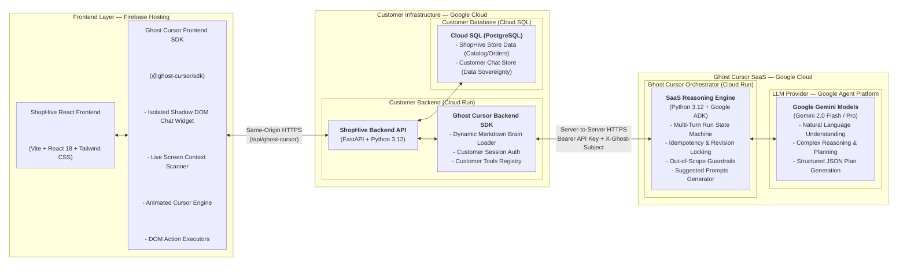

# 👻 Ghost Cursor — Hackathon Presentation (Slide-by-Slide)

---

## Slide 1: Brief About the Idea (Q1)

* **What is Ghost Cursor?**  
  A plug-and-play B2B SaaS platform that turns passive chatbots into **screen-aware autonomous co-pilots**.
* **Core Value Proposition:**  
  Traditional bots tell users what to do; Ghost Cursor **performs the actual task** on the user's screen in real-time.
* **How It Operates:**  
  1. Lightweight Frontend SDK (~5 lines) embeds an interactive chat widget and an in-browser executor.  
  2. Customer Backend Gateway SDK (~6 lines) automatically resolves dynamic page-specific business context (Brain) and routes requests.  
  3. Hosted Orchestrator (built in Python 3.12 with **Google Agent Development Kit (ADK)** & Gemini 2.0 on GCP) invokes fixed frontend action tools (`navigate`, `click`, `fill_input`).  
  4. An animated **Ghost Cursor** navigates, clicks, and fills forms directly on the customer's web app upon user approval.
* **Outcome:** Eliminates user drop-offs, reduces support tickets by up to 70%, and provides seamless guided onboarding.

---

## Slide 2: Opportunities & Market Differentiators (Q2)

* **How It Differs from Existing Tools:**  
  * *Traditional Bots (Intercom, Zendesk):* Only deliver static text/FAQs; cannot interact with the UI.  
  * *Digital Adoption Platforms (WalkMe, Pendo):* Rely on rigid, pre-recorded scripts; cannot reason dynamically.  
  * *Ghost Cursor:* Combines dynamic LLM reasoning + live DOM awareness + autonomous visual execution.
* **Problem Solved:**  
  Ends navigation drop-offs and complex form abandonment. Users avoid manual searching while businesses slash customer support overhead.
* **Unique Selling Proposition (USP):**  
  > **"Don't just explain the steps — execute them."**  
  * **Frontend Tools as Agent Tools:** The Google ADK Agent calls fixed frontend action tools; the SDK deterministically executes them.  
  * **Dynamic Business Brain:** Zero technical tags. The backend SDK dynamically pairs `platform.md` with `{page}.md` to supply pure business rules.  
  * **True Plug-and-Play Integration:** Zero redesign needed; embeds in ~11 lines of code across modern frameworks.

---

## Slide 3: List of Features Offered (Q3)

1. **🖥️ Screen-Aware Guidance:**  
   Inspects live DOM elements, form values, and routes to give hyper-accurate, page-specific answers instead of generic documentation.
2. **🎯 AI Cursor Auto-Actions:**  
   Fixed frontend execution tools (`navigate`, `click`, `fill_input`, `toggle_switch`) animate an on-screen cursor and execute tasks.
3. **❓ Smart Clarifying Questions:**  
   Detects missing inputs or ambiguities and prompts the user with quick-reply cards prior to executing sensitive steps.
4. **🎬 Guided Explainers:**  
   Renders dynamic spotlights, interactive tooltips, and narrated tours across the interface to onboard users.
5. **📊 Internal Business Tools:**  
   Directly queries customer APIs and analytics to provide live data backed response making it platform native.

---

## Slide 4: Process Flow & Use-Case Diagram (Q4)

```mermaid

%%{init: {
  "theme": "base",
  "themeVariables": {
    "background": "#FFFFFF",
    "mainBkg": "#FFFFFF",
    "primaryColor": "#FFFFFF",
    "primaryTextColor": "#172B4D",
    "primaryBorderColor": "#64748B",
    "lineColor": "#64748B",
    "secondaryColor": "#F1F6FC",
    "tertiaryColor": "#FFF3EA",
    "clusterBkg": "#FFFFFF",
    "clusterBorder": "#B8C5D6",
    "fontFamily": "Arial",
    "fontSize": "13px"
  },
  "flowchart": {
    "htmlLabels": true,
    "curve": "linear",
    "nodeSpacing": 20,
    "rankSpacing": 32,
    "padding": 6,
    "useMaxWidth": true
  }
}}%%

flowchart LR
    EU["End User"]
    ADMIN["Customer Admin / Developer"]

    subgraph CUSTOMER["CUSTOMER PLATFORM"]
        direction TB
        CHAT(["Chat & Task Delegation"])
        CONTEXT(["Capture Screen Context"])
        BRAIN(["Enrich with Platform Brain"])
        CUSTOM(["Register Custom Tools"])
        EXEC(["Execute Backend Tools"])
        UI(["Execute Approved UI Actions"])
        DISPLAY(["Display Answer & Guidance"])

        CHAT --> CONTEXT --> BRAIN
        CUSTOM -.-> BRAIN
        EXEC --> DISPLAY
        UI --> DISPLAY
    end

    subgraph SAAS["GHOST CURSOR SAAS"]
        direction TB
        REQ(["Receive Enriched Request"])
        REASON(["Reason & Select Tools"])
        PLAN(["Generate Tool Instructions"])
        ORCH(["Orchestrate Multi-Step Calls"])
        RESULTS(["Process Results & Continue"])
        FINAL(["Return Final Response"])

        REQ --> REASON --> PLAN
        PLAN --> ORCH --> RESULTS
        RESULTS -. "More steps" .-> REASON
        RESULTS --> FINAL
    end

    EU --- CHAT
    EU --- UI
    EU --- DISPLAY
    ADMIN --- CUSTOM

    BRAIN --> REQ
    PLAN --> BRAIN
    BRAIN --> EXEC
    BRAIN --> UI
    FINAL --> DISPLAY

    classDef actor fill:#FFFFFF,stroke:#334155,color:#172B4D,stroke-width:1.5px
    classDef customer fill:#F1F6FC,stroke:#5279A5,color:#173653,stroke-width:1.2px
    classDef saas fill:#FFF3EA,stroke:#D87942,color:#663718,stroke-width:1.2px

    class EU,ADMIN actor
    class CHAT,CONTEXT,BRAIN,CUSTOM,EXEC,UI,DISPLAY customer
    class REQ,REASON,PLAN,ORCH,RESULTS,FINAL saas

    style CUSTOMER fill:#FFFFFF,stroke:#5279A5,stroke-width:1.5px
    style SAAS fill:#FFFFFF,stroke:#D87942,stroke-width:1.5px

    linkStyle default stroke:#64748B,stroke-width:1.2px

```



* **Core Actors:** End-User (natural interaction, task delegation, approval gate) & Business Admin (branding, capabilities, Brain configuration).

---

## Slide 5: Wireframes / User Experience (Q5)

```
[1. Screen-Aware Chat]         [2. AI Cursor in Action]          [3. Smart Clarification]
┌────────────────────────┐     ┌────────────────────────┐        ┌────────────────────────┐
│ Context: Project Phoenix│    │ Setting: Appearance    │        │ Action Requires Input: │
│ Page:    Dashboard     │     │ Mode:    [Light] ➔ [🌙]│        │                        │
│                        │     │                ↑       │        │ 🤖 Would you like me   │
│ 🧑 "Turn the appearance│     │           👻 ──┘       │        │    to save this for all│
│    to dark mode"       │     │ (Ghost cursor clicks   │        │    workspaces?         │
│                        │     │  settings & toggles)   │        │ [📍 Current Only]      │
│ 🤖 "I will navigate to │     │                        │        │ [🌐 All Workspaces]    │
│ Settings & flip toggle"│     │ 🌙 [ Dark Mode Active ]│        │                        │
└────────────────────────┘     └────────────────────────┘        └────────────────────────┘
```

* Zero-friction modal overlays run within isolated **Shadow DOM**, ensuring the host app's styling never breaks.

---

## Slide 6: Architecture Diagram (Q6)



---

## Slide 7: Technologies Used (Q7)

* **Agentic Framework:** **Google Agent Development Kit (ADK)** in Python 3.12 for agentic orchestration, tool selection, function calling (`navigate`, `click`, `fill_input`, `select_option`, `toggle_switch`, `guided_tour`), multi-step execution, discrete plan validation, and human-in-the-loop approvals.
* **AI & LLM Engine:** **Google Gemini models** (Gemini 3.5 Flash) via Google Agent Platform as the LLM provider for natural-language understanding, context-aware action planning, dynamic suggested questions generation, and strict out-of-scope guardrails.
* **Cloud Infrastructure (Google Cloud Platform):**  
  * *Firebase Hosting:* Global CDN hosting and deployment of the React-based frontend application.  
  * *Cloud Run:* Serverless container hosting with autoscaling for **two independent backend services**:  
    1. **Ghost Cursor SaaS Orchestrator:** The multi-tenant reasoning and state management engine.  
    2. **ShopHive Demo Customer Backend:** The customer API gateway and SDK proxy.  
  * *Cloud SQL (PostgreSQL):* Persistent managed storage for ShopHive's application data (catalog, orders) and customer-owned chat store, ensuring complete customer data sovereignty.  
  * *Google Cloud:* Managed infrastructure for deploying, securing, and operating Ghost Cursor cloud services.  
  * *Secret Manager:* Secure credential management for tenant service keys and GCP credentials.
* **Ghost Cursor SDKs:**  
  * *Frontend SDK (`@ghost-cursor/sdk`):* Embeddable chat interface within an isolated Shadow DOM (`Plus Jakarta Sans` typography, sanitized markdown renderer), live screen-context capture, animated Ghost Cursor, and in-browser DOM action execution with approval controls.  
  * *Backend SDK (`@ghost-cursor/backend` / `ghost_cursor` Python):* Customer-platform context enrichment via dynamic Markdown Brain loader (`platform.md` + page-specific `.md`), gateway request proxying to Ghost Cursor SaaS, session identity injection (`X-Ghost-Subject`), and customer backend tools registration (`lookup_order`, `simulate_discount_roi`).
* **Backend Runtime:** Python 3.12, FastAPI, asynchronous request handling, Pydantic v2 validation, SQLAlchemy (asyncio with `greenlet`), and PostgreSQL connectivity (`asyncpg`).
* **Frontend Core:** React 18, TypeScript, Tailwind CSS, Vite, native DOM MutationObserver, and Web Component Shadow DOM APIs (`<ghost-cursor-widget>`) for total style isolation.
* **Demo Customer — ShopHive:** A fully functional e-commerce platform demonstrating end-to-end SDK integration, customer-specific Brain context, customer database tools, SaaS communication, and execution of AI-directed actions within a customer's application.

---

## Slide 8: Implementation & Infrastructure Cost (Q8)

* **Prototype Build Effort:**  
  * 48 hours / 3–4 developers across Frontend SDK, Python ADK Cloud Run Orchestrator, Customer Gateway, and Demo App.
* **GCP Infrastructure Cost (Prototype):**  
  * **~$5 – $15 total** (Cloud Run & Cloud SQL within low-tier budgets; costs driven almost entirely by Gemini token usage).
* **Production SaaS Unit Economics:**  
  * **~$0.005 – $0.01 per conversation** using Gemini 2.0 Flash context caching.  
  * High-margin B2B SaaS model ($299 to $999/month tiers).

---

## Slide 9: Future Scope & Roadmap (Q9)

* **Phase 1: Developer Ecosystem (1–3 Months)**  
  * Self-serve web console for tenant keys and private Brain management.  
  * Multi-agent hierarchies in Google ADK for parallel sub-workflows.  
  * Client-side action undo/rollback recording.
* **Phase 2: Multimodal & Accessibility (3–6 Months)**  
  * Visual perception using Gemini 2.0 Vision for canvas, WebGL, and complex non-DOM dashboards.  
  * Voice-driven input and live audio navigation via Web Speech API.
* **Phase 3: Enterprise Platform (6–12 Months)**  
  * 1-click turnkey integrations for Shopify, Salesforce, and WordPress.  
  * Dedicated enterprise VPC deployments with Bring Your Own Key (BYOK) encryption and SOC2 Type II compliance.
